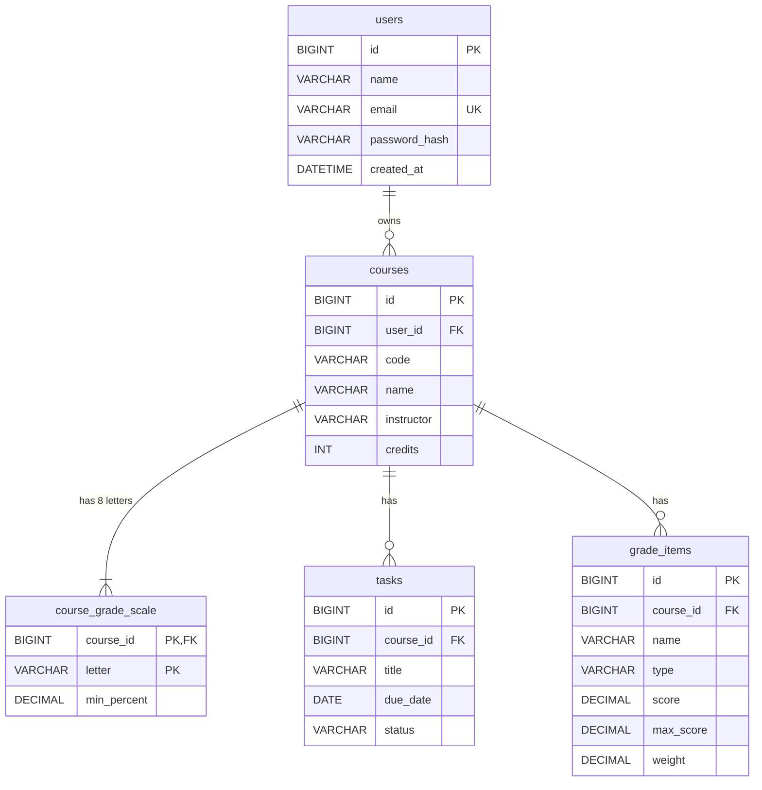

# Student Study Planner

A web app for students to manage their courses, homework and due dates, see everything on a calendar, and track grades. It includes a grade calculator and a "what-if" calculator that shows the final exam score needed for each target grade.

University course project, run with Docker Compose.

## Tech stack

| Layer | Technology |
|---|---|
| Frontend | Plain HTML, CSS and JavaScript (no framework, no build step) |
| Backend | Spring Boot 4 (Java 17), REST API, Spring Security (session cookie, BCrypt, CSRF) |
| Database | MySQL 8.4, viewed with phpMyAdmin |
| Deploy | Docker Compose: `db`, `backend`, `phpmyadmin` |

Spring Boot serves the frontend files itself, so there is no separate frontend container. The app and the API share one origin (`http://localhost:8080`).

## Folder structure

```
.
├── docker-compose.yml        # db + backend + phpmyadmin
├── Dockerfile                # multi-stage: build WAR with Maven (JDK 17), run with JRE
├── .env.example              # template for .env (real secrets go in .env, never committed)
├── design/                   # design reference (prototype), not shipped
└── demo/                     # Spring Boot project
    ├── pom.xml
    ├── scripts/api_2c.sh     # end-to-end API test with curl
    └── src/
        ├── main/java/com/studyplanner/
        │   ├── config/       # security configuration
        │   ├── controller/   # REST endpoints under /api
        │   ├── service/      # business logic and validation
        │   ├── repository/   # Spring Data JPA
        │   ├── entity/       # JPA entities
        │   ├── dto/          # request/response objects
        │   ├── exception/    # one JSON error shape for every error
        │   └── security/     # login user, CSRF cookie, JSON 401/403
        ├── main/resources/
        │   ├── application.properties
        │   ├── schema.sql    # database tables
        │   └── static/       # frontend: *.html, css/, js/, img/
        └── test/             # automated tests (H2 in-memory database)
```

## How to run

Requirements: [Docker Desktop](https://www.docker.com/products/docker-desktop/) (running). Java and Maven are not needed on your machine.

1. Create `.env` from the template and set your own passwords:
   ```bash
   cp .env.example .env
   ```
   Edit `.env` and replace the placeholder values of `MYSQL_ROOT_PASSWORD` and `DB_PASSWORD`.
2. Build and start everything:
   ```bash
   docker compose up --build
   ```
3. Open the app at **http://localhost:8080** and register a new account. New accounts get sample courses, tasks and grades; set `APP_SAMPLE_DATA=false` in `.env` to start empty.
4. Open phpMyAdmin at **http://localhost:8081**. Log in with `DB_USER` and `DB_PASSWORD` from your `.env`, then open the `studyplanner` database.

Other useful commands:

```bash
docker compose down        # stop (data is kept in the db_data volume)
docker compose down -v     # stop and delete all data
bash demo/scripts/api_2c.sh   # check the API while the app is running (Git Bash)
cd demo && ./mvnw test        # automated tests (no MySQL needed)
```

## Main features

- **Accounts**: register, log in and log out. Every user sees only their own data.
- **Courses**: add, edit and delete courses (code, name, instructor, credits). Deleting a course also deletes its tasks and grades.
- **Tasks**: homework with due dates and a status (To Do, In Progress, Done) that can be changed inline. "Overdue" is worked out from the due date. Tasks can be grouped by status or by course and filtered by course.
- **Dashboard**: task overview, upcoming deadlines and a monthly calendar with colored task chips and today highlighted.
- **Grades**: assessments with score, max score, weight and type (Coursework, Midterm, Final). They can be edited inline or in a form, and invalid values are never saved. The current grade is calculated only from graded assessments.
- **Grade scale per course**: the minimum % for each letter (A, B+, B, C+, C, D+, D, F) can be edited, with a reset to default (A ≥ 80 … D ≥ 50).
- **What-if calculator**: the final exam score needed for each target grade, with the assumption shown on screen (remaining assessments are assumed at the current average).
- **Responsive dark UI**: works on mobile, where forms open as bottom sheets.

## Database diagram



- **users**: one row per account. `email` is unique. Passwords are stored only as BCrypt hashes (`password_hash`), never as plain text.
- **courses**: each course belongs to one user (`user_id`). A user cannot have two courses with the same `code` (unique `user_id` + `code`). `credits` must be 1–6.
- **course_grade_scale**: the grade scale of a course, one row per letter (A, B+, B, C+, C, D+, D, F), so 8 rows per course. The primary key is (`course_id`, `letter`). `min_percent` is the lowest percentage for that letter, and F is always 0.
- **tasks**: homework for a course. `status` is `TODO`, `IN_PROGRESS` or `DONE`. Overdue is not stored; it is calculated from `due_date`.
- **grade_items**: assessments of a course. `type` is `COURSEWORK`, `MIDTERM` or `FINAL`. `score` is `NULL` when the assessment is not graded yet (it never counts as 0). Check constraints keep the values valid: `max_score > 0`, `0 < weight ≤ 100`, and `0 ≤ score ≤ max_score`.

Tasks and grade items belong to a user through their course. Every foreign key uses `ON DELETE CASCADE`: deleting a course removes its grade scale, tasks and grade items, and deleting a user removes all of their courses. The tables are created by `demo/src/main/resources/schema.sql` when the backend starts.
